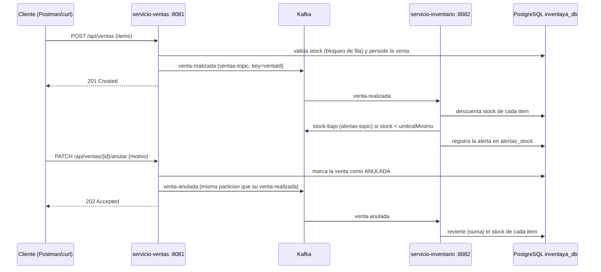

# InventaYa

Sistema distribuido de gestion de inventario y ventas para pymes (minimercados, tiendas de
barrio y negocios similares). Monorepo Java 21 / Spring Boot 3.3 con microservicios que se
comunican por eventos Kafka y comparten una sola base PostgreSQL (`inventaya_db`).

## Grupo

- Grupo 3 — Equipo 3
- Anne Sofia Fierro Ortiz
- David Alejandro Reyes Perez
- Jaime Andres Guacarapare Sotelo

## Versión entregada e índice de repositorios

| Dato | Valor |
|---|---|
| Repositorio (único, monorepo) | https://github.com/David-ReyesPe/inventaya |
| Versión entregada (etiqueta / release) | `v1.0.0-entrega-final` |
| Commit de la versión entregada | `a37a985` |
| ZIP entregado | Generado desde ese mismo commit (`git archive`), ver `docs/manual-tecnico.md` |

No existen otros repositorios: backend, frontend, contratos, documentación y Compose viven en este monorepo.

## Tecnologías y versiones

| Capa | Tecnología | Versión |
|---|---|---|
| Backend | Java / Spring Boot | 21 / 3.3.5 |
| Mensajería | Apache Kafka (KRaft) / Spring Kafka | 3.8.0 |
| Base de datos | PostgreSQL + Flyway | 16 |
| API / seguridad | springdoc-openapi / JJWT | 2.6.0 / 0.12.6 |
| Frontend | HTML + CSS + JS sobre nginx | nginx 1.27 |
| Contenedores | Docker Compose | v2 |
| Pruebas | JUnit 5, Mockito, MockMvc, H2 | (Spring Boot 3.3.5) |

Detalle completo en `docs/manual-tecnico.md`.

## Alcance de esta entrega

El diseno completo (cuatro servicios) esta en `docs/PA_G3_Equipo3_Entrega2P1.pdf`. Esta
entrega implementa los dos servicios del nucleo del flujo; los otros dos quedan definidos
por contrato y comentados en `docker-compose.yml`.

| Servicio | Puerto | Responsabilidad | Estado |
|---|---|---|---|
| `servicio-ventas` | 8081 | Registro, consulta y anulacion de ventas. Publica `venta-realizada` y `venta-anulada`. | Implementado |
| `servicio-inventario` | 8082 | Catalogo de productos, control de stock y alertas. Consume los eventos de venta y publica `stock-bajo`. | Implementado |
| `interfaz-web` | 8083 | Interfaz grafica de ventas, inventario y dashboard de notificaciones. | Implementado |
| `servicio-notificaciones` | - | Consumo de `stock-bajo` y envio de notificaciones. | **Pendiente (sin codigo)** |
| `gateway-graphql` | - | Fachada GraphQL unificada. | **Pendiente (solo contrato `schema.graphqls`)** |

Documentación:

- Instalación, ejecución y pruebas: **[GUIA.md](GUIA.md)**
- Arquitectura y diagramas: **[docs/arquitectura.md](docs/arquitectura.md)**
- Manual técnico: **[docs/manual-tecnico.md](docs/manual-tecnico.md)**
- API: **[docs/api.md](docs/api.md)** y `contratos/`
- Matriz de pruebas y evidencias: **[docs/pruebas/matriz-pruebas.md](docs/pruebas/matriz-pruebas.md)**, `docs/evidencias/`
- Revisión contra los criterios: **[docs/verificacion-criterios.md](docs/verificacion-criterios.md)**
- Informe final: `docs/FOGI10__Informe_final_Proyecto_de_Aula.docx`

## Flujo funcional



Las ventas nunca se editan: un registro incorrecto se anula y se crea una venta nueva con
los datos corregidos.

El registro de ventas entra por REST directo desde el POS, no por GraphQL: el POS necesita
baja latencia e integracion simple contra un solo servicio, mientras que el valor del
Gateway GraphQL esta en agregar datos de varios servicios para el Dashboard Administrativo.

## Decisiones de arquitectura vigentes

Vienen de la Entrega 2 P1 y esta implementacion las respeta sin cambios:

1. **Sin simulador de ventas.** El propio Servicio de Ventas cumple el rol de productor de
   eventos.
2. **Una sola base de datos compartida** (`inventaya_db`) entre Ventas e Inventario, en
   lugar de una base por servicio, para simplificar el MVP.
3. **Ventas con multiples productos.** Una venta puede tener una o varias lineas (`items`).
4. **Las ventas no se editan, se anulan.** Ante un error la venta se marca como `ANULADA`
   (evento `venta-anulada`, que revierte el stock) y se registra una venta nueva y correcta.
   Asi se mantiene el historial completo y la consistencia del inventario.
5. **El registro de ventas entra por REST desde el POS, no por GraphQL.** El Gateway se
   reserva para consultas agregadas del dashboard y operaciones administrativas
   (`crearProducto`, `anularVenta`).

Dos pendientes que esa entrega dejo abiertos y que esta cierra: el **mecanismo de
autenticacion JWT** (ver "Seguridad") y la **implementacion de los servicios de Ventas e
Inventario**. La politica de reintentos y dead-letter queue sigue pendiente (ver
"Limitaciones conocidas").

## Estructura del monorepo

```
InventaYa/
├── pom.xml                                  agregador (mvn test compila y prueba todo)
├── docker-compose.yml                       stack completo del entorno local
├── .env.example                             variables de ejemplo (copiar a .env)
├── GUIA.md                                  guia de arranque y pruebas
├── scripts/                                 cargar_seed.sh, insertar_datos_prueba.sh, prueba_e2e.sh
├── db/seed/datos_prueba.sql                 datos ficticios
├── docs/
│   ├── arquitectura.md, manual-tecnico.md, api.md
│   ├── pruebas/matriz-pruebas.md            matriz de pruebas
│   ├── evidencias/                          logs y capturas
│   ├── FOGI10__Informe_final_Proyecto_de_Aula.docx
│   ├── PA_G3_Equipo3_Entrega2P1.pdf         documento de arquitectura
│   └── verificacion-criterios.md            revision contra los criterios de la entrega
├── contratos/
│   ├── openapi-servicio-ventas.yaml         generados desde el codigo (ver "Contratos")
│   ├── openapi-servicio-inventario.yaml
│   ├── schema.graphqls                      contrato del gateway (entrega futura)
│   └── entrega-2-p1-aprobados/              contratos originales, para trazar los cambios
├── kafka/
│   └── kafka-eventos.md                     definicion de topicos y eventos
├── servicio-ventas/                         Dockerfile + src/{main,test}
├── servicio-inventario/                     Dockerfile + src/{main,test}
├── interfaz-web/                            interfaz grafica (nginx + app estatica)
│   ├── Dockerfile
│   ├── nginx.conf                           sirve la interfaz y hace de proxy a las dos APIs
│   └── html/
│       ├── ventas.html                      punto de venta
│       ├── inventario.html                  catalogo y stock
│       ├── dashboard.html                   indicadores y notificaciones
│       └── assets/                          estilos.css, api.js, comunes.js y un js por pantalla
├── servicio-notificaciones/                 entrega futura
└── gateway-graphql/                         entrega futura
```

Cada servicio implementado sigue el mismo layout de paquetes: `config` (seguridad, Kafka,
OpenAPI), `controller`, `dto`, `entity`, `repository`, `service`, `kafka`, `exception`,
`mapper`.

## Requisitos previos

- Docker Desktop / Engine con Docker Compose v2 (para el arranque completo)
- JDK 21 y Maven 3.9+ (solo si vas a compilar o correr pruebas fuera de Docker)
- Puertos libres: 5432, 8080, 8081, 8082, 8083, 8084, 9092, 29092

**Dependencias externas:** Docker Hub (imagenes) y Maven Central (dependencias, durante el build dentro de Docker). No se usan servicios de terceros (correo, SMS, pagos).

## Orden de ejecucion

1. `cp .env.example .env` (en PowerShell: `Copy-Item .env.example .env`)
2. `docker compose up -d --build`
3. `docker compose ps` hasta que todo este `healthy`
4. (Opcional) `./scripts/cargar_seed.sh` y `./scripts/insertar_datos_prueba.sh`
5. Abrir http://localhost:8083
6. (Opcional) `./scripts/prueba_e2e.sh`

Si habia un volumen de PostgreSQL anterior con otras credenciales: `docker compose down -v`.

## Arranque

```bash
docker compose up -d --build
```

Eso levanta PostgreSQL 16, Kafka, Kafka UI, pgAdmin, los dos servicios y la interfaz grafica (red `inventaya-net`). El primer
arranque compila ambos modulos dentro de sus imagenes, asi que tarda algunos minutos.

| Que | Donde |
|---|---|
| Interfaz grafica | http://localhost:8083 |
| Swagger UI Ventas | http://localhost:8081/swagger-ui.html |
| Swagger UI Inventario | http://localhost:8082/swagger-ui.html |
| Contrato OpenAPI (JSON / YAML) | `http://localhost:808X/v3/api-docs` y `/v3/api-docs.yaml` |
| Kafka UI (topicos y mensajes) | http://localhost:8080 |
| Health de cada servicio | `http://localhost:808X/actuator/health` |
| pgAdmin | http://localhost:8084 (credenciales en `.env`) |
| PostgreSQL | `localhost:5432`, base `inventaya_db`, usuario/clave segun `.env` |
| Kafka desde el host | `localhost:29092` (desde los contenedores: `kafka:9092`) |

Para ver el estado y los logs:

```bash
docker compose ps
docker compose logs -f servicio-inventario
```

`servicio-inventario` es el dueno del esquema: al arrancar ejecuta las migraciones Flyway
que crean las 5 tablas. `servicio-ventas` espera a que inventario este sano antes de
arrancar, y trabaja sobre las mismas tablas sin migrar nada.

## Interfaz grafica

En **http://localhost:8083** hay una interfaz con tres pantallas que consumen las APIs REST de
los dos servicios:

| Pantalla | Que permite | Requisitos que cubre |
|---|---|---|
| **Ventas** | Armar una venta con varios items (con subtotales y total en vivo), registrarla, filtrar el historico por fecha con paginacion, ver el detalle de cada venta y anularla con motivo. | RF2, RF7 |
| **Inventario** | Crear productos, editar nombre/precio/umbral, ajustar stock con `INCREMENTO` o `DECREMENTO` y ver el catalogo paginado con los productos bajo umbral resaltados. | RF1 |
| **Dashboard** | Indicadores de catalogo, ventas y facturacion; lista de notificaciones de stock bajo con filtro por atendida y paginacion; productos por reponer; refresco automatico con aviso de alertas nuevas. | RF3, RF4, RF6 |

La barra superior emite el token JWT de prueba con el rol elegido (`ADMIN` o `USER`) y lo guarda
en la sesion del navegador. Cambiar de rol permite comprobar el control de permisos: con `USER`,
crear productos o anular ventas devuelve **403** y la interfaz lo explica en pantalla.

Decisiones de esta interfaz:

- **Es una app estatica servida por nginx, sin paso de build ni dependencias de Node.** Es un
  contenedor mas del compose y se construye en segundos.
- **nginx tambien hace de reverse proxy hacia los dos servicios**, enrutando por prefijo:
  `/api/ventas` a Ventas, `/api/productos` y `/api/alertas` a Inventario. El enrutado no es
  ambiguo porque los dos servicios no comparten rutas. Al quedar la interfaz y las APIs bajo el
  mismo origen, el navegador no necesita CORS y **los servicios no cambian nada por existir este
  front**.
- **No reemplaza al `gateway-graphql`** de la entrega futura: la interfaz habla REST directo con
  cada servicio, tal como estaba previsto para el punto de venta.
- Los errores que muestra la interfaz son los que devuelve el backend en el esquema
  `ErrorResponse`, no mensajes inventados en el cliente.

## Token JWT de prueba

Todos los endpoints de negocio exigen `Authorization: Bearer <token>`. Con el perfil `dev`
activo (como queda en Docker Compose) cada servicio expone un emisor de tokens de prueba.
Los dos servicios comparten la misma clave simetrica, asi que un token vale para ambos.

```bash
# Token de administrador (puede crear/editar productos, ajustar stock y anular ventas)
curl "http://localhost:8081/api/dev/token?role=ADMIN"

# Token de usuario normal (puede registrar y consultar, pero no anular ni administrar)
curl "http://localhost:8081/api/dev/token?role=USER&subject=cajero1"
```

Respuesta:

```json
{
  "token": "eyJhbGciOiJIUzUxMiJ9...",
  "tipo": "Bearer",
  "rol": "ADMIN",
  "expiraEnSegundos": 7200
}
```

Guarda el token en una variable para los ejemplos siguientes:

```bash
# bash / Git Bash / WSL
TOKEN=$(curl -s "http://localhost:8081/api/dev/token?role=ADMIN" | sed -E 's/.*"token":"([^"]+)".*/\1/')
```

```powershell
# PowerShell
$TOKEN = (Invoke-RestMethod "http://localhost:8081/api/dev/token?role=ADMIN").token
```

### Población rápida de datos para probar paginación

Para insertar automáticamente un lote de 20 productos y 20 ventas variadas y validar la paginación con múltiples páginas en la interfaz:

```powershell
powershell -ExecutionPolicy Bypass -File .\insertar_datos_prueba.ps1
```

Fuera del perfil `dev` la ruta `/api/dev/token` no existe (404) y los tokens deben emitirse
con la clave configurada en `INVENTAYA_JWT_SECRET`.

## Ejemplos curl

Los ejemplos usan sintaxis bash. En PowerShell, reemplaza `$TOKEN` igual (funciona), usa
`curl.exe` y comillas dobles escapadas en el JSON, o utiliza directamente Swagger UI /
Postman, que es lo mas cómodo para capturar evidencias.

### Inventario - catalogo y stock (:8082)

```bash
# Registrar un producto (requiere rol ADMIN) -> 201
curl -X POST http://localhost:8082/api/productos \
  -H "Authorization: Bearer $TOKEN" \
  -H "Content-Type: application/json" \
  -d '{ "nombre": "Arroz 500g", "precio": 3200, "stockInicial": 50, "umbralMinimo": 10 }'

# Listar productos (paginado opcional) -> 200 + X-Total-Count
curl -i "http://localhost:8082/api/productos?page=0&size=20" -H "Authorization: Bearer $TOKEN"

# Consultar un producto -> 200 / 404
curl http://localhost:8082/api/productos/<productoId> -H "Authorization: Bearer $TOKEN"

# Editar nombre, precio y umbral (ADMIN) -> 200
curl -X PUT http://localhost:8082/api/productos/<productoId> \
  -H "Authorization: Bearer $TOKEN" -H "Content-Type: application/json" \
  -d '{ "nombre": "Arroz premium 500g", "precio": 3500, "umbralMinimo": 15 }'

# Ajustar stock por recepcion de mercancia (ADMIN) -> 200
curl -X PUT http://localhost:8082/api/productos/<productoId>/stock \
  -H "Authorization: Bearer $TOKEN" -H "Content-Type: application/json" \
  -d '{ "operacion": "INCREMENTO", "cantidad": 30 }'

# Descontar mas de lo disponible -> 409 Conflict
curl -X PUT http://localhost:8082/api/productos/<productoId>/stock \
  -H "Authorization: Bearer $TOKEN" -H "Content-Type: application/json" \
  -d '{ "operacion": "DECREMENTO", "cantidad": 99999 }'

# Alertas de stock bajo (todas / solo pendientes) -> 200
curl "http://localhost:8082/api/alertas" -H "Authorization: Bearer $TOKEN"
curl "http://localhost:8082/api/alertas?atendida=false&page=0&size=20" -H "Authorization: Bearer $TOKEN"
```

### Ventas (:8081)

```bash
# Registrar una venta con dos lineas -> 201 Created
curl -X POST http://localhost:8081/api/ventas \
  -H "Authorization: Bearer $TOKEN" -H "Content-Type: application/json" \
  -d '{
        "items": [
          { "productoId": "<productoId1>", "cantidad": 3, "precioUnitario": 4500 },
          { "productoId": "<productoId2>", "cantidad": 1, "precioUnitario": 8000 }
        ]
      }'

# Venta sin items -> 400 Bad Request
curl -X POST http://localhost:8081/api/ventas \
  -H "Authorization: Bearer $TOKEN" -H "Content-Type: application/json" \
  -d '{ "items": [] }'

# Venta que supera el stock disponible -> 409 Conflict
curl -X POST http://localhost:8081/api/ventas \
  -H "Authorization: Bearer $TOKEN" -H "Content-Type: application/json" \
  -d '{ "items": [ { "productoId": "<productoId1>", "cantidad": 99999, "precioUnitario": 4500 } ] }'

# Sin token -> 401 Unauthorized
curl -i -X POST http://localhost:8081/api/ventas \
  -H "Content-Type: application/json" -d '{ "items": [] }'

# Listar ventas con filtros de fecha y paginacion -> 200
curl -i "http://localhost:8081/api/ventas?desde=2026-01-01T00:00:00Z&hasta=2026-12-31T23:59:59Z&page=0&size=20" \
  -H "Authorization: Bearer $TOKEN"

# Consultar una venta -> 200 / 404
curl http://localhost:8081/api/ventas/<ventaId> -H "Authorization: Bearer $TOKEN"

# Anular una venta (requiere ADMIN) -> 202 Accepted
curl -X PATCH http://localhost:8081/api/ventas/<ventaId>/anular \
  -H "Authorization: Bearer $TOKEN" -H "Content-Type: application/json" \
  -d '{ "motivo": "Cantidad registrada por error, se corrige con una nueva venta." }'

# Anular la misma venta otra vez -> 409 Conflict
# Anular con un token de rol USER -> 403 Forbidden
```

Todos los errores responden con el mismo schema:

```json
{ "codigo": 409, "mensaje": "La venta ya fue anulada previamente.", "timestamp": "2026-08-19T15:32:00Z" }
```

### Como ver el efecto end to end

1. Crea un producto con `stockInicial: 12` y `umbralMinimo: 10`.
2. Registra una venta de 8 unidades de ese producto.
3. Consulta el producto en Inventario: el stock quedo en 4 (lo descontó el consumidor).
4. Consulta `GET /api/alertas`: hay una alerta con `stockActual: 4` y `umbralMinimo: 10`.
5. En Kafka UI (http://localhost:8080) revisa `ventas-topic` y `alertas-topic`.
6. Anula la venta y vuelve a consultar el producto: el stock volvio a 12.

En Windows conviene hacerlo con PowerShell en lugar de `curl`, porque `curl.exe` recibe el
JSON inline con las comillas ya alteradas por el shell y la API responde 400. Este script
recorre el flujo completo:

```powershell
$t = (Invoke-RestMethod "http://localhost:8081/api/dev/token?role=ADMIN").token
$h = @{ Authorization = "Bearer $t"; "Content-Type" = "application/json" }

# 1) Producto que quedara bajo su umbral con una sola venta
$p = Invoke-RestMethod -Method Post -Uri "http://localhost:8082/api/productos" -Headers $h `
     -Body '{"nombre":"Arroz 500g","precio":3200,"stockInicial":12,"umbralMinimo":10}'

# 2) Venta de 8 unidades -> 201 Created
$v = Invoke-RestMethod -Method Post -Uri "http://localhost:8081/api/ventas" -Headers $h `
     -Body ('{"items":[{"productoId":"' + $p.id + '","cantidad":8,"precioUnitario":4500}]}')

Start-Sleep -Seconds 3
# 3) y 4) Stock descontado a 4 y alerta generada
(Invoke-RestMethod "http://localhost:8082/api/productos/$($p.id)" -Headers $h).stock
Invoke-RestMethod "http://localhost:8082/api/alertas?atendida=false" -Headers $h

# 6) Anulacion -> 202 Accepted y stock de vuelta en 12
Invoke-WebRequest -UseBasicParsing -Method Patch -Headers $h `
  -Uri "http://localhost:8081/api/ventas/$($v.id)/anular" `
  -Body '{"motivo":"Cantidad registrada por error, se corrige con una nueva venta."}'
Start-Sleep -Seconds 3
(Invoke-RestMethod "http://localhost:8082/api/productos/$($p.id)" -Headers $h).stock
```

Para inspeccionar el estado real por debajo:

```powershell
# Particiones de los topicos (ventas-topic = 3, alertas-topic = 1)
docker exec inventaya-kafka /opt/kafka/bin/kafka-topics.sh --bootstrap-server localhost:9092 --describe --topic ventas-topic

# Eventos publicados
docker exec inventaya-kafka /opt/kafka/bin/kafka-console-consumer.sh --bootstrap-server localhost:9092 --topic alertas-topic --from-beginning --timeout-ms 6000

# Bitacora de idempotencia y estado de las ventas
docker exec inventaya-postgres psql -U inventaya -d inventaya_db -c "select tipo, count(*) from eventos_procesados group by tipo;"
```

## Eventos Kafka

La definicion completa esta en `kafka/kafka-eventos.md`; aqui va el resumen de lo
implementado.

| Topico | Particiones | Key | Productor | Consumidor |
|---|---|---|---|---|
| `ventas-topic` | 3 | `ventaId` | servicio-ventas | servicio-inventario (`inventario-service-group`) |
| `alertas-topic` | 1 | `productoId` | servicio-inventario | servicio-notificaciones (pendiente) |

Todos los eventos comparten el mismo sobre:

```json
{
  "eventoId": "8f3a1b2c-0000-4a11-9c22-abc123456789",
  "tipo": "venta-realizada",
  "fecha": "2026-08-19T15:32:00Z",
  "payload": { }
}
```

- **`venta-realizada`**: `payload` con `ventaId`, `items` (`productoId`, `cantidad`,
  `precioUnitario`, `subtotal`) y `total`.
- **`venta-anulada`**: `payload` con `ventaId`, `motivo` e `items` (`productoId`, `cantidad`).
- **`stock-bajo`**: `payload` con `productoId`, `stockActual` y `umbralMinimo`.

Dos garantias explicitas del diseno:

- **Idempotencia.** Cada `eventoId` que Inventario aplica queda registrado en la tabla
  `eventos_procesados`. Si el mismo evento se reentrega (reintento, rebalanceo, redeploy),
  se ignora y el stock no se mueve dos veces.
- **Orden.** Al usar `ventaId` como key, la `venta-realizada` y la `venta-anulada` de una
  misma venta caen en la misma particion y se procesan en ese orden.

Los eventos se publican de forma sincrona dentro de la transaccion que los origina: si
Kafka rechaza el evento, la operacion se revierte y el endpoint responde 500, en lugar de
dejar la venta registrada y el inventario sin enterarse.

## Modelo de datos

Una sola base `inventaya_db` compartida, con migraciones Flyway versionadas en
`servicio-inventario/src/main/resources/db/migration`.

| Tabla | Para que |
|---|---|
| `productos` | Catalogo con stock y umbral minimo |
| `ventas` | Cabecera de la venta (total, estado, motivo de anulacion, fecha) |
| `venta_items` | Lineas de la venta (FK a `ventas` y a `productos`) |
| `alertas_stock` | Historico de cada vez que un producto cayo bajo su umbral |
| `eventos_procesados` | Bitacora de `eventoId` aplicados (idempotencia del consumidor) |

Se eligio Flyway sobre `ddl-auto=update` porque dos aplicaciones comparten el esquema: con
`update` ambos Hibernate intentarian ajustarlo al arrancar. Con Flyway hay un unico dueno
(`servicio-inventario`), las migraciones quedan versionadas en el repo y `servicio-ventas`
corre con `ddl-auto=none` y Flyway deshabilitado.

## Contratos OpenAPI

Los YAML de `contratos/` **se generan desde el codigo**: la prueba `ContratoOpenApiIT` de
cada servicio pide `/v3/api-docs.yaml`, valida que sigan estando todos los endpoints y
codigos acordados, y reescribe el archivo. Es decir, `mvn test` los mantiene sincronizados
con la implementacion y no pueden quedar desfasados. Los contratos tal como se aprobaron en
la Entrega 2 P1 quedan en `contratos/entrega-2-p1-aprobados/` para poder contrastarlos.

Todos los paths, verbos y codigos de estado de los contratos aprobados se implementaron sin
cambios. Lo que se agrega es aditivo:

- **Paginacion** (`page`, por defecto 0; `size`, por defecto 20) en `GET /api/ventas`,
  `GET /api/productos` y `GET /api/alertas`. La respuesta devuelve un objeto `PaginaResponse`
  con los elementos en el campo `contenido` (y su alias `items`), junto con los parámetros
  `tienePaginaSiguiente`, `tienePaginaAnterior`, `totalElementos`, `totalPaginas`, `paginaActual` y `tamanoPagina`,
  además de mantener los encabezados HTTP `X-Total-Count`, `X-Total-Pages`, `X-Page`, `X-Page-Size`, `X-Has-Next` y `X-Has-Previous`.
- **`GET /api/alertas`** con filtro opcional `atendida` y paginacion, para cubrir RF6. Sus
  campos se llaman `stockActual` y `umbralMinimo`, igual que en el payload del evento
  `stock-bajo` y en el tipo `Alerta` de `schema.graphqls`, de modo que el Gateway pueda
  proyectar la respuesta sin traducir nombres. Cuando exista `servicio-notificaciones`, este
  endpoint sigue siendo la fuente de registro: `alertas_stock` la escribe Inventario.
- **`PUT /api/productos/{id}`** para editar nombre, precio y umbral minimo, y completar el
  CRUD de productos de RF1. El stock no se toca aqui.
- En `POST /api/ventas`, un `productoId` que no existe en el catalogo responde **400**
  (dato de entrada invalido). El **409** queda reservado para el caso de stock insuficiente,
  tal como lo define el contrato.

## Seguridad

JWT firmado con una clave simetrica compartida (`INVENTAYA_JWT_SECRET`, HMAC-SHA). Un filtro
(`JwtAuthFilter`) valida el token y responde 401 con el schema `ErrorResponse`; un
interceptor (`RolInterceptor`) lee la anotacion `@RolRequerido` del endpoint y responde 403
si el claim `role` no alcanza.

| Operacion | Rol requerido |
|---|---|
| Consultar productos, alertas y ventas; registrar una venta | ADMIN o USER |
| Crear o editar productos, ajustar stock, anular una venta | ADMIN |

Rutas publicas: `/actuator/**`, `/v3/api-docs/**`, `/swagger-ui/**` y `/api/dev/**` (que
solo existe con el perfil `dev`).

## Pruebas

```bash
mvn test          # ambos servicios
mvn -f servicio-ventas/pom.xml test
mvn -f servicio-inventario/pom.xml test
```

No hace falta Docker ni un broker levantado: las pruebas usan H2 en memoria y sustituyen
unicamente los productores de Kafka.

| Prueba | Que cubre |
|---|---|
| `VentaServiceTest` | Reglas de negocio con Mockito: rechazo por stock insuficiente, suma de lineas del mismo producto, producto inexistente, calculo de totales, doble anulacion |
| `VentaControllerIT` | MockMvc sobre H2: 201, 400, 409, 401, 403, 404, 202 y el filtro de fechas |
| `VentaRepositoryIT` | `@DataJpaTest`: filtro `desde`/`hasta`, paginacion y carga de las lineas |
| `ProductoServiceTest` | Ajustes de stock con Mockito, incluido el 409 y el disparo de alerta |
| `ProductoControllerIT` | MockMvc sobre H2 para productos y alertas, con roles y errores |
| `VentasEventListenerIT` | El consumidor real contra la base real: descuento (RF3), alerta (RF4), reversion (RF7), idempotencia por `eventoId`, mensajes ilegibles y stock que nunca queda negativo |
| `VentaEventProducerTest` | El JSON publicado en `ventas-topic` y su key. Como los dos servicios no comparten clases, este JSON *es* el contrato entre ellos: junto con `VentasEventListenerIT` es la unica garantia automatica de que productor y consumidor siguen de acuerdo |
| `ContratoOpenApiIT` | Genera y valida el contrato OpenAPI de cada servicio |

## Limitaciones conocidas

- **Validacion de stock vs. descuento asincrono.** Ventas valida el stock con un bloqueo de
  fila antes de registrar, pero el descuento real lo aplica Inventario al consumir el evento.
  Dos ventas del mismo producto emitidas en paralelo pueden pasar ambas la validacion; en
  ese caso el consumidor descuenta hasta cero, deja un WARN en el log y nunca deja el stock
  negativo. La reserva de stock en el momento de la venta queda para una iteracion futura.
- **Sin dead-letter queue.** Un mensaje ilegible se descarta con un log de ERROR para no
  bloquear la particion. La decision sobre `ventas-topic-dlq` esta pendiente, tal como
  indica el documento de eventos.
- **Alertas de solo lectura.** `atendida` existe en el modelo y se puede filtrar, pero
  todavia no hay endpoint para marcar una alerta como atendida.
- **`servicio-notificaciones` y `gateway-graphql` (GraphQL, RF5) estan pendientes**: no se implementan en esta entrega y
  quedan comentados en `docker-compose.yml`.
- **La interfaz emite el token con el emisor del perfil `dev`,** no con un login real. Es
  suficiente para operar y evaluar la entrega, pero no es un mecanismo de autenticacion para
  produccion.
- **Los indicadores del dashboard se calculan en el cliente** sobre la primera pagina de 200
  registros, que es el maximo que aceptan las APIs. Con volumenes mayores harian falta endpoints
  de agregacion en cada servicio.
- **La interfaz no tiene pruebas automatizadas.** Se verifico manualmente en el navegador contra
  el stack de Docker Compose; la logica de negocio que ejercita si esta cubierta por las pruebas
  de los servicios.
