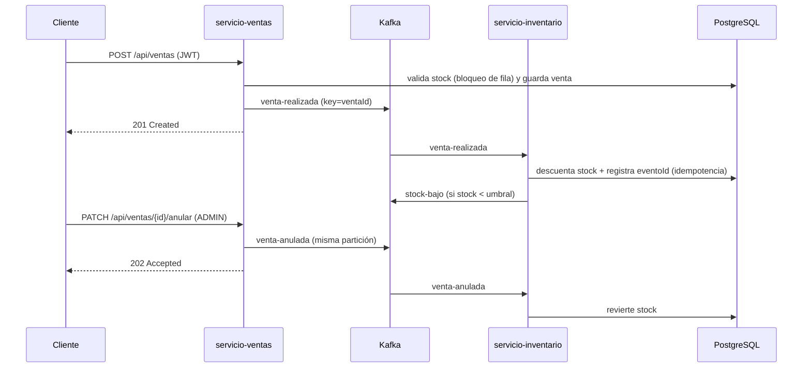
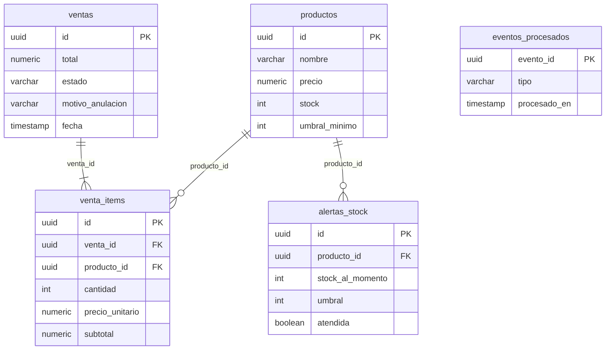

# Arquitectura implementada de InventaYa

Este documento describe lo que **efectivamente está implementado** en la versión entregada. Lo que está
solo definido por contrato o pendiente se marca expresamente (sección 5).

## 1. Vista de componentes

```mermaid
flowchart LR
    U[Usuario / navegador] -->|HTTP :8083| WEB[interfaz-web<br/>nginx 1.27 + HTML/JS]
    POS[Cliente REST<br/>Postman / curl / POS] -->|REST + JWT| V
    WEB -->|/api/ventas| V[servicio-ventas :8081<br/>Spring Boot]
    WEB -->|/api/productos<br/>/api/alertas| I[servicio-inventario :8082<br/>Spring Boot]
    V -- "publica venta-realizada<br/>venta-anulada" --> K[(Kafka 3.8 KRaft<br/>ventas-topic x3<br/>alertas-topic x1)]
    K -- "consume (inventario-service-group)" --> I
    I -- "publica stock-bajo" --> K
    V -->|JDBC| DB[(PostgreSQL 16<br/>inventaya_db)]
    I -->|JDBC + Flyway| DB
    KUI[Kafka UI :8080] -.-> K
    PGA[pgAdmin :8084] -.-> DB
    K -. "consumidor pendiente" .-> N[servicio-notificaciones<br/>NO IMPLEMENTADO]
    G[gateway-graphql<br/>NO IMPLEMENTADO] -. contrato schema.graphqls .-> V
    G -.-> I
```

Líneas punteadas hacia `servicio-notificaciones` y `gateway-graphql` = componentes **pendientes** (sin código).

## 2. Responsabilidades

| Componente | Puerto | Responsabilidad | Se comunica con |
|---|---|---|---|
| `interfaz-web` | 8083 | Interfaz gráfica (ventas, inventario, dashboard). nginx sirve la app estática y hace de proxy inverso por prefijo de ruta (sin CORS). | REST → ventas e inventario |
| `servicio-ventas` | 8081 | Registrar, consultar y anular ventas multi-ítem. Valida stock con bloqueo de fila. Publica `venta-realizada` y `venta-anulada`. | PostgreSQL (JDBC), Kafka (productor) |
| `servicio-inventario` | 8082 | Catálogo, stock y alertas. Consume eventos de venta (idempotente), descuenta/revierte stock, publica `stock-bajo`. Dueño del esquema (Flyway). | PostgreSQL, Kafka (consumidor y productor) |
| PostgreSQL 16 | 5432 | Base compartida `inventaya_db` (5 tablas). | ventas, inventario, pgAdmin |
| Kafka 3.8.0 (KRaft) | 9092 / 29092 | Bus de eventos. `ventas-topic` (3 particiones, key `ventaId`) y `alertas-topic` (1 partición, key `productoId`). | ventas, inventario, Kafka UI |
| Kafka UI | 8080 | Inspección de tópicos y mensajes (herramienta de apoyo). | Kafka |
| pgAdmin | 8084 | Inspección de la base (herramienta de apoyo). | PostgreSQL |

## 3. Flujos de comunicación



Comunicación **síncrona**: cliente → REST. Comunicación **asíncrona**: ventas → Kafka → inventario (consistencia eventual).
Los servicios no se llaman entre sí por HTTP; comparten la base de datos (decisión aprobada en la Entrega 2 P1).

## 4. Modelo de datos



## 5. Estado de componentes (implementado vs. pendiente)

| Componente / característica | Estado |
|---|---|
| servicio-ventas, servicio-inventario | Implementado |
| interfaz-web | Implementado |
| Kafka (ventas-topic, alertas-topic), PostgreSQL, Flyway, JWT/roles, OpenAPI | Implementado |
| Docker Compose (red `inventaya-net`, volúmenes `postgres_data`, `pgadmin_data`) | Implementado |
| `gateway-graphql` (GraphQL) | **Pendiente.** Solo existe el contrato `contratos/schema.graphqls`. Sin código ni contenedor. |
| `servicio-notificaciones` (RF5) | **Pendiente.** El evento `stock-bajo` se publica pero nadie lo consume aún; las alertas se leen por `GET /api/alertas`. |
| Dead-letter queue / reintentos | **Pendiente** |
| Endpoint para marcar alerta como atendida | **Pendiente** |
| Reserva de stock en el momento de la venta | **Pendiente** (ver limitación de concurrencia en el README) |
| Autenticación real (login) | **Pendiente.** Solo existe el emisor de tokens del perfil `dev`. |

## 6. Despliegue

Un solo `docker-compose.yml` (proyecto `inventaya`, red `inventaya-net`). Orden de arranque garantizado por
`depends_on` + healthchecks: `postgres` y `kafka` → `servicio-inventario` (migra el esquema) → `servicio-ventas` → `interfaz-web`.
